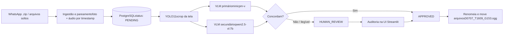

# Glicovoz — Pipeline de Rotulagem Auditável para Imagens de Glicosímetros

Pipeline para ingestão, extração e rotulagem de dados (fotos de glicosímetros pareadas com áudios de voz) enviados por pacientes via WhatsApp ou coleta local. A leitura do valor de glicemia é feita por **dois modelos de visão (VLMs) locais em consenso**, com **revisão humana (Human-in-the-Loop)** para os casos em que os modelos discordam.

> ⚠️ **Aviso:** este projeto é uma ferramenta de construção de datasets. **Não é um dispositivo médico** e não deve ser usado para decisões clínicas.

---

## Resultados

Avaliação de desempenho baseada em **840 imagens** totalmente auditadas por um humano (Human-in-the-Loop):

| Métrica | Resultado |
| --- | --- |
| Total de Imagens Auditadas | **840** pares imagem + áudio |
| **`qwen2.5-vl:7b`** (Validador) acertou | **715** (~85,1%) |
| **`minicpm-v`** (Primário) acertou | **691** (~82,2%) |
| Ambos erraram (Com Discordância) | **42** (~5,0%) |
| 🚨 Erros Críticos Mútuos | **14** (~1,6%) |

**Como interpretar:**
- **Erros Críticos Mútuos (1,6%):** É o dado mais importante do sistema. Representa os raros casos onde os dois modelos (MiniCPM e Qwen) leram a imagem de forma idêntica, **mas o valor estava errado** (falsos positivos de consenso que passaram pela auto-aceitação).
- **Qwen2.5-VL se destaca:** Sendo um modelo mais pesado e avançado em raciocínio espacial, ele acertou mais leituras que o MiniCPM-V, confirmando sua utilidade como um validador forte para desempatar casos complexos.
- **Ambos Erraram (5%):** Casos onde a imagem estava ilegível, tremida demais, ou com muito reflexo, fazendo com que a IA discordasse (e errasse a tentativa). Esses caem corretamente na fila de Revisão Humana.

---

## 🔄 Fluxo de Processamento



1. **Ingestão:** dados brutos são organizados em `data/input/<id_paciente>/` e fotos e áudios são pareados por proximidade de timestamp.
2. **Registro:** o pipeline headless indexa os arquivos no banco com status `PENDING`.
3. **Detecção (crop):** o YOLO11s recorta a foto para manter apenas a tela do glicosímetro.
4. **Leitura em consenso:** a imagem recortada é lida de forma independente por dois VLMs. Se os valores coincidem, o item é `APPROVED`; caso contrário (discordância, erro ou ilegível), vai para `HUMAN_REVIEW`.
5. **Auditoria (HITL):** a interface web permite confirmar ou corrigir rapidamente a fila de revisão.
6. **Finalização:** arquivos com rótulo final são renomeados e movidos para `data/output/`.

---

## Arquitetura

| Componente | Responsabilidade |
| --- | --- |
| **Ollama + YOLO** | Inferência local (GPU ou CPU) dos modelos de detecção e visão-linguagem |
| **PostgreSQL** | Fila de trabalho e fonte da verdade: status, resultados de cada VLM, logs de ações e métricas |
| **Pipeline headless** (`api/pipeline.py`) | Processo em lote que consome itens `PENDING`, gera crops, chama os VLMs e grava resultados |
| **Streamlit UI** (`ui/app.py`) | Front-end que lê direto do banco, com filtros, auditoria manual e gestão de discordâncias. Pode também disparar o lote, mas o modo recomendado é rodar o pipeline headless em um processo separado (ver [Como usar](https://claude.ai/chat/ee77eae6-05af-4180-8ed0-4e18ac172a7e#%EF%B8%8F-como-usar)) |

**Decisões de projeto**

- **Banco como fila:** persistir cada etapa permite retomar o processamento após interrupções, sem perder histórico.
- **Pipeline separado da UI:** rodando o pipeline como processo headless, o painel continua responsivo durante a inferência pesada e a revisão pode acontecer em paralelo. Se o lote for iniciado de dentro do Streamlit, ele fica preso à sessão do navegador e é interrompido ao navegar ou recarregar a página.
- **Sem dependência de APIs externas:** todo o processamento é local, sem envio de imagens ou áudios a terceiros. Isso reduz a superfície de risco com dados sensíveis, mas **não equivale, por si só, a conformidade com LGPD/HIPAA**.

---

## Interface (Streamlit)

O menu lateral tem seis modos de operação:

| Modo | Para que serve |
| --- | --- |
| **Pipeline Automático** | Inicia, pausa ou reprocessa lotes, com console de logs em tempo real (YOLO e leituras dos dois VLMs) |
| **Galeria Auditável** | Visão por paciente: recorte do visor ao lado da foto original, status de cada imagem (aprovada, em revisão) e a leitura de cada modelo |
| **Revisão Humana (HITL)** | Fila de discordâncias (ex.: um modelo leu 142 e o outro 147). Revisão imagem a imagem ou em massa, com o humano definindo o valor correto |
| **Rotulagem Manual** | Rotula um paciente sem IA: mostra o recorte, toca o áudio e o valor é digitado com Enter |
| **Filtro de Intervalo** | Isola em `_fora_da_faixa` os arquivos fora de um intervalo de data/hora (ex.: fotos que não são de glicosímetro enviadas por engano) |
| **Métricas & Auditoria DB** | Total processado, taxa de auto-aceitação e comparação de qual modelo (primário ou secundário) mais erra nos casos corrigidos por humano |

---

## Stack

- **Linguagem:** Python 3.10+
- **UI:** [Streamlit](https://streamlit.io/)
- **Persistência:** [PostgreSQL](https://postgresql.org/) via Docker + [SQLAlchemy](https://www.sqlalchemy.org/) (SQLite como fallback para desenvolvimento local)
- **Detecção do display:** [YOLO11s](https://github.com/ultralytics/ultralytics), modelo pequeno que roda em CPU se necessário
- **VLMs locais:** [Ollama](https://ollama.ai/)

### Modelos VLM

Configuráveis no `.env` (`VLM_PRIMARY_MODEL` e `VLM_SECONDARY_MODEL`). Padrão:

- **`minicpm-v` (primário):** modelo leve, com bom desempenho em leitura de texto e displays, e baixo consumo de VRAM.
- **`qwen2.5-vl:7b` (validador):** segundo leitor independente, com boa compreensão de layout, útil para distinguir o valor da medição de relógio, data e memórias.

Os dois prompts pedem apenas o valor de glicose, ignorando os demais elementos do display.

---

## Otimizações

1. **Singleton do YOLO:** o modelo é carregado uma única vez e reutilizado, evitando o custo de carga a cada imagem.
2. **Crop dinâmico com margem:** o YOLO isola o aparelho antes do envio ao VLM, com margem de segurança configurável. Isso remove fundo e reflexos irrelevantes e reduz o tamanho da imagem enviada ao modelo.
3. **Desacoplamento banco × disco:** a UI consulta o banco em vez de varrer o sistema de arquivos. A sincronização de rótulos com os nomes de arquivo é feita sob demanda ("Sincronizar Rótulos no Disco").
4. **Retomada após falhas:** se o processamento for interrompido, a busca de itens pendentes inclui os que ficaram em `PROCESSING`, então uma nova execução retoma de onde parou. Itens já `APPROVED` ou `HUMAN_REVIEW` são ignorados.

<!-- TODO (opcional): se você tiver benchmarks (tempo por imagem com/sem crop, com/sem singleton), coloque os números aqui. Sem medição, prefira não citar ganhos numéricos. -->

---

## Estrutura de Mídia

```text
data/
├── input/                 # Material bruto por paciente (ex: P11_F50/)
├── crops/                 # Recortes do visor gerados pelo YOLO11
├── output/
│   ├── aprovados/         # Arquivos rotulados e aprovados (consenso ou humano)
│   └── revisao_humana/    # Fila de quarentena para auditoria
└── dataset_treino.jsonl   # Exemplos aprovados em formato LLaVA (JSONL), para eventual fine-tuning
```

---

## Como usar

**1. Dependências**

```bash
python3 -m venv .venv
source .venv/bin/activate
pip install -r requirements.txt
```

Instale o [Ollama](https://ollama.ai/), inicie o serviço e baixe os modelos:

```bash
ollama pull minicpm-v
ollama pull qwen2.5-vl:7b
```

**2. Variáveis de ambiente**

```bash
cp .env.example .env
```

Ajuste as credenciais do PostgreSQL e os modelos VLM, se desejar.

**3. Banco de dados**

```bash
docker compose up -d db
```

**4. Importar dados do WhatsApp** (etapa inicial)

```bash
python run.py
# Escolha [B] para importar um export de conversa (.zip)
```

**5. Executar o pipeline e a interface (recomendado: dois terminais)**

Terminal 1: interface, usada para monitoramento e revisão humana.

```bash
python run_pipeline.py
# Escolha [1] para abrir o Streamlit em http://localhost:8501
```

Terminal 2: processamento em lote, headless, independente do navegador.

```bash
python run_pipeline.py
# Escolha [2] para executar o pipeline automático headless
```

Assim você revisa itens no Streamlit enquanto a IA processa o lote em background. Iniciar o lote pela própria interface funciona para lotes pequenos, mas ele é abortado se você fechar a aba, recarregar ou trocar de modo no menu.

---

## Desempenho e Escalabilidade

O processamento completo (YOLO + Inferência dupla de VLMs) leva, em média, **4 segundos por imagem** em hardwares comuns. Devido a esse tempo, o cenário de uso ideal é deixar o processamento rodando em background (via terminal headless) enquanto se utiliza a interface apenas para auditoria posterior.

Em cenários de **maior escala de dados**, a arquitetura atual permite as seguintes otimizações:
- **Processamento Concorrente:** Refatoração do motor para multithreading, onde múltiplos *workers* processam itens em paralelo.
- **Flexibilidade de Pipeline:** Substituição imediata dos modelos base por outros VLMs sem afetar a lógica central.
- **Validação de Qualidade:** Possibilidade de modificar a etapa final para validar o desempenho utilizando abordagens de avaliação baseadas em JEV (*JSON Evaluation*) para extrações mais complexas ou meta-validações estruturadas automatizadas.

---

## Limitações e próximos passos

**Limitações**

- Sem validação clínica; o objetivo é rotulagem de dados, não diagnóstico.
- Consenso não garante acerto: os dois VLMs podem errar da mesma forma (erros correlacionados). A revisão humana continua necessária para uso confiável.
- Avaliação em ~1.000 amostras, um único anotador e um único tipo de coleta. Os resultados podem não generalizar para outros aparelhos ou condições de iluminação.
- Depende de hardware com capacidade razoável para rodar os VLMs localmente.
- **Sem controle de concorrência entre pipelines:** dois processos iniciados ao mesmo tempo leem a mesma lista de itens pendentes e processam os mesmos itens duas vezes. Como a busca também inclui itens em `PROCESSING`, um segundo pipeline pode pegar itens que o primeiro ainda está processando. Isso desperdiça recursos, mas o processamento é idempotente e não corrompe o banco.
- **Item preso em `PROCESSING`:** se o lote é disparado pela UI e a sessão é interrompida no meio de uma imagem, o item permanece nesse status até a próxima execução.

**Próximos passos**

- Evitar processamento duplicado com *row locking* no PostgreSQL (`SELECT ... FOR UPDATE SKIP LOCKED`), permitindo vários workers em paralelo.
- Medir e reportar a taxa de "concordância com erro" (ambos os modelos errados e iguais).
- Testes automatizados e dataset sintético de exemplo.
- Fine-tuning com o `dataset_treino.jsonl` gerado pelas revisões humanas.
- Estratégia de desempate (terceiro modelo ou re-leitura com outro crop) antes de enviar à revisão humana, já que a maioria das discordâncias é de 1 dígito.

---

## Privacidade

Este repositório **não contém dados de pacientes**. As pastas `data/` e o arquivo `.env` estão no `.gitignore`. Se for usar o projeto com dados reais, siga as exigências legais aplicáveis (ex.: LGPD), incluindo consentimento e anonimização.

---

## Licença

Distribuído sob a licença MIT. Veja [`LICENSE`](LICENSE) para mais informações.

---

## Agradecimentos

O script original de coleta e organização de áudios (`run.py`, `scripts/0_export_from_whatsapp.py`, `1_prepare.py`, `2_finalize.py`) foi desenvolvido por [Ícaro Delay](https://github.com/icarodelay) como parte de um projeto acadêmico de coleta manual de dados. Todo o pipeline de rotulagem automática com VLMs, o sistema de banco de dados, a interface Streamlit, a arquitetura de consenso dual-modelo e a camada de auditoria HITL foram desenvolvidos por [Arthur Azevedo](https://github.com/arthurazv).