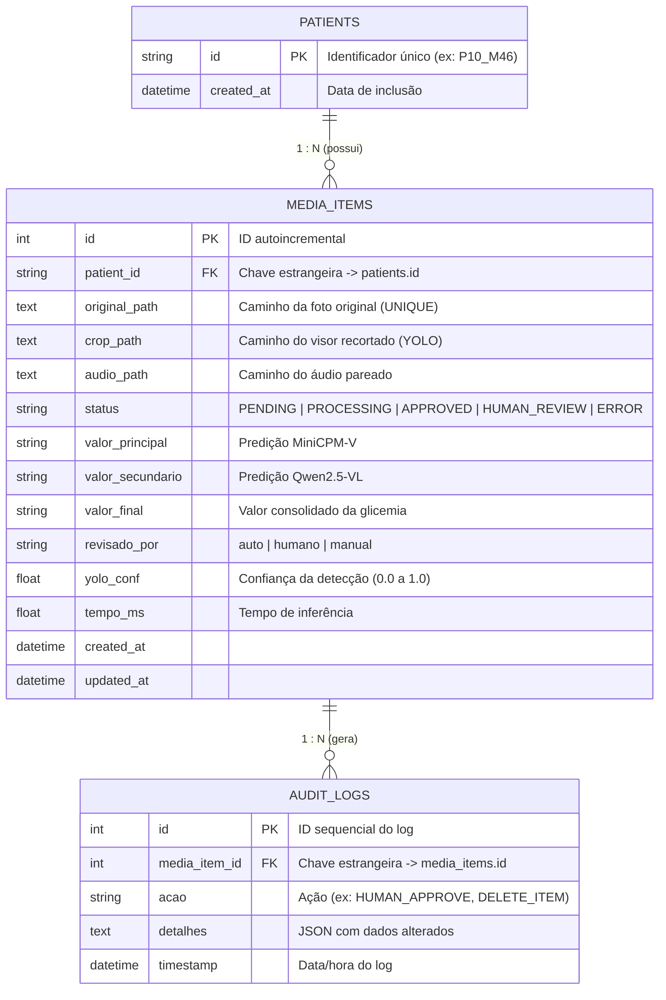

# 📚 Guia de Estudo: Banco de Dados Relacional e SQLAlchemy (ORM)

Este guia foi elaborado a partir da arquitetura real do projeto **GlicoVoz / Audio Collect Helper** ([api/database.py](file:///home/arthurazv/vscode/audio-collect-helper/api/database.py)) para servir de material de estudo prático e conceitual.

---

## 1. O que é um Banco de Dados Relacional e ORM?

### SGBD Relacional (RDBMS)
Um **Sistema de Gerenciamento de Banco de Dados Relacional** (como PostgreSQL, MySQL ou SQLite) armazena informações estruturadas em **tabelas bidimensionais** (linhas e colunas) conectadas entre si por relações lógicas.

### O que é o SQLAlchemy?
O **SQLAlchemy** é uma biblioteca Python que atua como **ORM (*Object-Relational Mapper*)**.

* **Sem ORM**: Você precisa escrever strings SQL manuais no código:
  ```python
  cursor.execute("SELECT * FROM media_items WHERE status = 'PENDING'")
  ```
* **Com ORM (SQLAlchemy)**: Você manipula instâncias de classes normais do Python:
  ```python
  pendentes = session.query(MediaItem).filter_by(status="PENDING").all()
  ```

### Vantagens do ORM:
1. **Portabilidade**: O mesmo código funciona em **SQLite** (banco local simples em arquivo) e **PostgreSQL** (banco robusto em servidor/Docker).
2. **Segurança**: Protege automaticamente contra ataques de **SQL Injection**.
3. **Produtividade**: Tipagem, autocompletar na IDE e validação de integridade orientada a objetos.

---

## 2. Elementos Fundamentais de Banco de Dados

| Conceito | Definição | Exemplo no Projeto |
| :--- | :--- | :--- |
| **Entidade / Tabela** | Representa uma classe de objetos do mundo real. | `patients`, `media_items`, `audit_logs` |
| **Atributo / Coluna** | Propriedade ou característica da entidade. | `id`, `original_path`, `status`, `valor_final` |
| **Registro / Tupla (Linha)** | Uma instância de dado concreta armazenada. | O registro com `id=10`, foto `P10_01.jpg` e status `APPROVED` |
| **Tipo de Dado** | Define o que a coluna aceita (Texto, Inteiro, Data...). | `Integer`, `String(100)`, `Text`, `DateTime`, `Float` |

---

## 3. Chaves, Índices e Restrições (*Constraints*)

### A. Chave Primária (*Primary Key* - PK)
* **Conceito**: Identificador **único e obrigatório** de cada registro na tabela. Nunca pode se repetir e nunca pode ser nulo (`NULL`).
* **Tipos comuns**:
  1. **Chave Natural**: Usa um identificador real do domínio. Ex: `Patient.id = "P10_M46"`.
  2. **Chave Substituta (*Surrogate Key*)**: Um contador inteiro sequencial automático (`autoincrement=True`). Ex: `MediaItem.id = 1, 2, 3...`.

### B. Chave Estrangeira (*Foreign Key* - FK)
* **Conceito**: Coluna que faz referência direta à Chave Primária de outra tabela.
* **Função**: Cria o vínculo relacional e garante a **Integridade Referencial** (impede salvar uma mídia para um paciente inexistente).
* **Exemplo**: `MediaItem.patient_id` aponta para `patients.id`.

### C. Restrições (*Constraints*)
* `unique=True`: Garante que nenhum registro repita o mesmo valor (ex: `original_path` não aceita fotos duplicadas).
* `nullable=False`: Campo obrigatório (não pode ser `NULL`).
* `default=...`: Valor padrão caso nenhum seja fornecido (ex: `default=datetime.utcnow`, `default="PENDING"`).

### D. Índices (*Indexes*)
* **O que são**: Estruturas de dados em árvore (B-Tree) criadas pelo banco para acelerar buscas sem varrer toda a tabela (*Full Table Scan*).
* **Quando usar**: Em colunas frequentemente usadas em filtros `WHERE` ou `JOIN`.
* **No projeto**: `status` e `patient_id` possuem `index=True` para acelerar a busca de itens pendentes e galerias.

---

## 4. Modelagem de Dados: MER e DER

### MER (*Modelo Entidade-Relacionamento*)
É o modelo conceitual que descreve o negócio através de **Entidades**, seus **Atributos** e seus **Relacionamentos**.

### DER (*Diagrama Entidade-Relacionamento*) do Projeto



### Cardinalidades:
1. **1:N (Um-para-Muitos / One-to-Many)**:
   * **1 Paciente** possui **Muitos Itens de Mídia**.
   * **1 Item de Mídia** possui **Muitos Registros de Auditoria**.
2. **Exclusão em Cascata (`cascade="all, delete-orphan"`)**:
   * Se um `Patient` for deletado, o SQLAlchemy deleta automaticamente todas as suas mídias filhas, evitando "dados órfãos".

---

## 5. Guia de Consultas: SQL Puro vs. SQLAlchemy ORM

Abaixo estão os exemplos das operações mais comuns para estudar e comparar:

---

### 1. Inserir Registro (`INSERT`)

* **SQL Puro**:
  ```sql
  INSERT INTO patients (id, created_at) 
  VALUES ('P10_M46', CURRENT_TIMESTAMP);

  INSERT INTO media_items (patient_id, original_path, status) 
  VALUES ('P10_M46', '/data/input/P10_M46/foto1.jpg', 'PENDING');
  ```

* **SQLAlchemy ORM**:
  ```python
  novo_paciente = Patient(id="P10_M46")
  session.add(novo_paciente)

  nova_midia = MediaItem(
      patient_id="P10_M46",
      original_path="/data/input/P10_M46/foto1.jpg",
      status="PENDING"
  )
  session.add(nova_midia)
  session.commit()
  ```

---

### 2. Buscar Todos e Buscar por Chave Primária (`SELECT / WHERE PK`)

* **SQL Puro**:
  ```sql
  -- Buscar mídia pelo ID 5
  SELECT * FROM media_items WHERE id = 5;
  ```

* **SQLAlchemy ORM**:
  ```python
  # Busca direta pela Chave Primária
  item = session.query(MediaItem).get(5)
  # Ou:
  item = session.query(MediaItem).filter_by(id=5).first()
  ```

---

### 3. Filtros Condicionais Simples e Múltiplos (`WHERE`, `AND`, `OR`, `IN`)

* **SQL Puro**:
  ```sql
  -- Buscar itens pendentes ou em processamento de um paciente específico
  SELECT * FROM media_items 
  WHERE patient_id = 'P10_M46' 
    AND status IN ('PENDING', 'PROCESSING')
  ORDER BY id ASC;
  ```

* **SQLAlchemy ORM**:
  ```python
  from sqlalchemy import or_

  itens = (
      session.query(MediaItem)
      .filter(
          MediaItem.patient_id == "P10_M46",
          MediaItem.status.in_(["PENDING", "PROCESSING"])
      )
      .order_by(MediaItem.id.asc())
      .all()
  )
  ```

---

### 4. Junção de Tabelas (`JOIN / INNER JOIN / LEFT JOIN`)

* **Cenário**: Listar cada foto junto com o `id` e `created_at` do seu respectivo paciente.

* **SQL Puro**:
  ```sql
  SELECT m.id, m.original_path, m.valor_final, p.id AS paciente, p.created_at AS paciente_desde
  FROM media_items m
  INNER JOIN patients p ON m.patient_id = p.id
  WHERE m.status = 'APPROVED';
  ```

* **SQLAlchemy ORM (Automático pelo Relationship ou Explícito)**:
  ```python
  # Modo 1: Navegação direta pelos objetos (graças ao relationship!)
  item = session.query(MediaItem).first()
  print(item.patient.id)          # O SQLAlchemy busca o paciente associado
  print(item.patient.created_at)

  # Modo 2: Join explícito de colunas selecionadas
  resultados = (
      session.query(MediaItem.id, MediaItem.valor_final, Patient.id)
      .join(Patient, MediaItem.patient_id == Patient.id)
      .filter(MediaItem.status == "APPROVED")
      .all()
  )
  ```

---

### 5. Agregações, Contagens e Métricas (`COUNT`, `AVG`, `GROUP BY`)

* **Cenário**: Contar quantas fotos existem por status e calcular o tempo médio de inferência.

* **SQL Puro**:
  ```sql
  SELECT 
      status, 
      COUNT(*) AS total_itens, 
      AVG(tempo_ms) AS tempo_medio_ms
  FROM media_items
  GROUP BY status;
  ```

* **SQLAlchemy ORM**:
  ```python
  from sqlalchemy import func

  relatorio = (
      session.query(
          MediaItem.status,
          func.count(MediaItem.id).label("total_itens"),
          func.avg(MediaItem.tempo_ms).label("tempo_medio_ms")
      )
      .group_by(MediaItem.status)
      .all()
  )

  for status, total, tempo_medio in relatorio:
      print(f"Status: {status} | Total: {total} | Média: {tempo_medio:.2f}ms")
  ```

---

### 6. Atualização de Registros (`UPDATE`)

* **Cenário**: Aprovar uma foto revisada por humano com o valor de glicemia corrigido.

* **SQL Puro**:
  ```sql
  UPDATE media_items 
  SET 
      valor_final = '128', 
      status = 'APPROVED', 
      revisado_por = 'humano', 
      updated_at = CURRENT_TIMESTAMP
  WHERE id = 12;
  ```

* **SQLAlchemy ORM**:
  ```python
  item = session.query(MediaItem).filter_by(id=12).first()
  if item:
      item.valor_final = "128"
      item.status = "APPROVED"
      item.revisado_por = "humano"
      item.updated_at = datetime.utcnow()
      session.commit()
  ```

---

### 7. Exclusão de Registros (`DELETE`)

* **SQL Puro**:
  ```sql
  -- Deleta o item (e se houver FK configurada com CASCADE, deleta os logs de auditoria)
  DELETE FROM media_items WHERE id = 12;
  ```

* **SQLAlchemy ORM**:
  ```python
  item = session.query(MediaItem).filter_by(id=12).first()
  if item:
      session.delete(item)
      session.commit()
  ```

---

### 8. Paginação (`LIMIT` e `OFFSET`)

* **Cenário**: Carregar a página 2 da galeria (10 itens por página).

* **SQL Puro**:
  ```sql
  SELECT * FROM media_items 
  ORDER BY id ASC 
  LIMIT 10 OFFSET 10;
  ```

* **SQLAlchemy ORM**:
  ```python
  pagina = 2
  itens_por_pagina = 10
  offset_val = (pagina - 1) * itens_por_pagina

  itens_paginados = (
      session.query(MediaItem)
      .order_by(MediaItem.id.asc())
      .offset(offset_val)
      .limit(itens_por_pagina)
      .all()
  )
  ```

---

## 6. Conceitos Avançados e Dicas Práticas

### Transações e ACID (`commit` e `rollback`)
* **Atomicidade / Consistência**: Todas as operações dentro de uma sessão só são salvas de verdade quando você chama `session.commit()`.
* Se algo der errado (exceção), você executa `session.rollback()` para cancelar as alterações pendentes e evitar corromper o banco.

```python
session = db.get_session()
try:
    # Passo 1: Atualiza a mídia
    item.status = "APPROVED"
    # Passo 2: Cria log de auditoria
    log = AuditLog(media_item_id=item.id, acao="HUMAN_APPROVE")
    session.add(log)
    
    session.commit()  # Salva ambos atomicamente
except Exception as e:
    session.rollback()  # Desfaz tudo se houver erro
    raise e
finally:
    session.close()
```

### Como ver a query SQL que o SQLAlchemy está gerando?
Para fins de estudo e depuração, você pode imprimir a instrução compilada diretamente:

```python
query = session.query(MediaItem).filter(MediaItem.status == "PENDING")
print(str(query))
# Saída no console:
# SELECT media_items.id AS media_items_id, media_items.patient_id AS media_items_patient_id, ... 
# FROM media_items WHERE media_items.status = :status_1
```
